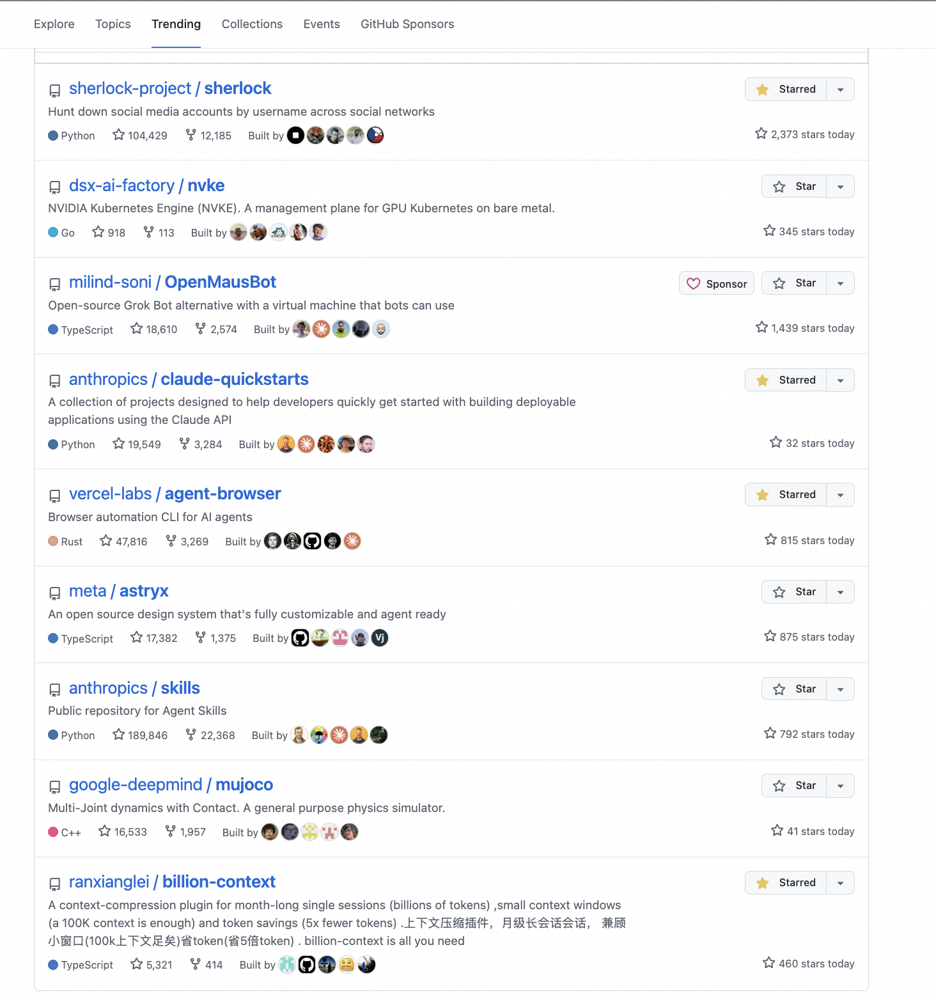
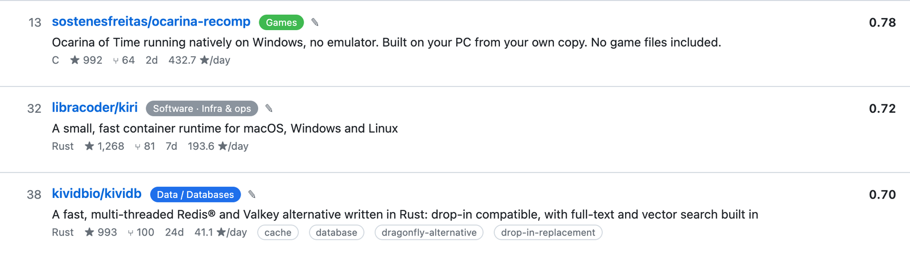
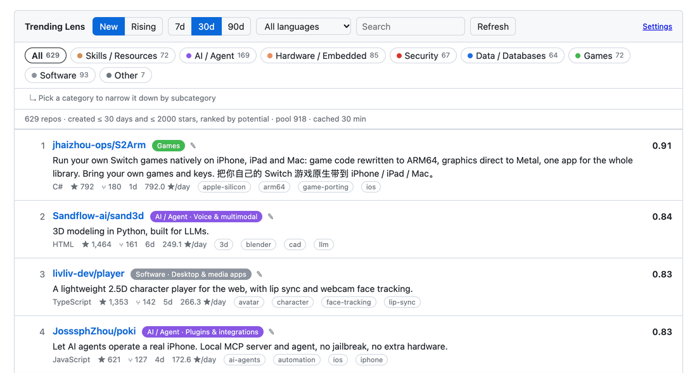

On a Friday night at 11pm, Andrej Karpathy opened YouTube, got a wall of what he called enshittified recommendations, and decided he had had enough. The next morning he pointed Opus 5.5 at Hacker News and asked for a YouTube built out of the videos people recommend in the comments. The agent read the archive, dropped spam, kept around 40,000 comments that recommended a specific video, and turned them into 6,454 videos across roughly 150 topics with a YouTube-like interface, deployed and hardened on a VPS. About two hours. He created an API key, booted the machine, and bought the domain.

What stays with me is that he never tried to beat YouTube's ranking. He changed where the list came from. Someone had already watched a talk, decided it was worth other engineers' time, and posted it in a thread where other engineers would read it. That is a recommendation with a cost attached, and no thumbnail can buy it.

## GitHub has the same problem

My Friday night is github.com/trending. This is what it showed while I was writing:

<figure style="margin: 2rem 0; text-align: center;">
  
  <figcaption style="margin-top:.6rem;opacity:.75;">Nine rows: Sherlock, NVKE, OpenMausBot, claude-quickstarts, agent-browser, astryx, anthropics/skills, mujoco, billion-context.</figcaption>
</figure>

The top two rows are a skills collection and a quickstart repo: `anthropics/skills` and `anthropics/claude-quickstarts`. The skills one has 189,846 stars and added another 792 today. I saw both on this page last month. They are still here.

Further down, Sherlock has 104,429 stars and MuJoCo 16,533. Both have been famous for years, and both are back on the chart. Most of this page looks like that: big projects returning every few weeks, with skills collections and quickstart repos taking several rows at a time.

I open this page with one question: what appeared in the last week that is worth looking at. It never answers. There are about ten rows, and half of them belong to repos that were already big before I started paying attention. A repo that appeared last Tuesday with 200 stars cannot get in, however good it is.

The same morning, my list surfaced [Kiri](https://github.com/libracoder/kiri), a container runtime for macOS, Windows and Linux that runs the Docker images you already have (1,268 stars in its first week). It also had [KiviDB](https://github.com/kividbio/kividb), a Redis-compatible database in Rust with full-text and vector search (993 stars), and [ocarina-recomp](https://github.com/sostenesfreitas/ocarina-recomp), which rebuilds Ocarina of Time into a native Windows program from your own copy (992 stars, three days old). None of them is on the page above.

<figure style="margin: 2rem 0; text-align: center;">
  
  <figcaption style="margin-top:.6rem;opacity:.75;">Rows 13, 32 and 38 of the same 629-repo New list, on 2026-11-09.</figcaption>
</figure>

So I built [Trending Lens](https://github.com/adlternative/gh-trending-lens), a Chrome extension that replaces the page with a list I compute myself, split into two brackets.

<figure style="margin: 2rem 0; text-align: center;">
  
  <figcaption style="margin-top:.6rem;opacity:.75;">The same list, browsed by category and subcategory.</figcaption>
</figure>

## Where the list comes from

Eleven GitHub Search API calls per refresh, cached for 30 minutes in `chrome.storage.local`. Three pages of `created:>=date stars:>=30 fork:false`, with the star floor moving to 50 and 80 for the 30 and 90 day windows. Two pages for older repos that are rising fast (`created:>=1y stars:>=2000`). Six keyword queries, one each for AI, hardware, security, games, data and ordinary software.

The keyword queries are there because the generic search returns almost nothing but AI repos. Without them, the hardware and games categories come back empty every time and the list is a worse version of the page I was trying to escape. Results are deduped by `full_name` before scoring.

## How the score works

Stars per day of existence, turned into a percentile inside the candidate pool, is 40%. Days since the last push is 20%. Fork-to-star ratio is 15%, open issues to stars 10%, and the final 15% goes to having a description, a license and topics (10%) and belonging to an organization (5%).

Every input is a field the search response already contains, so a refresh is those 11 requests and nothing else. The weights are a guess. Open issues even count in the wrong direction: more issues, higher score.

## New and rising

The New tab holds repos created inside the selected window, 7, 30 or 90 days, with at most 2,000 stars. The Rising tab holds repos created within the last year that already passed 2,000 stars.

They are separate because the score is relative. Star velocity is a percentile inside the pool, so a five-day-old repo with 300 stars has to be measured against repos of a similar size. Put it next to a ten-month-old project with 20k stars and the percentile stops meaning anything. Two brackets let a small repo win the New list on its own speed, which is the list I actually read. Rising is for the other question: what is accelerating among projects that already have an audience.

## How a repo gets a category

Keyword rules over name, description and topics. A rule hit adds its weight, capped at three matches per rule, and the highest total wins. The skills category carries the highest weight because it is the one that steals repos from everywhere else. A second pass inside the winning category picks a subcategory: Agent CLI, models and inference, memory and RAG, browser automation, and so on.

Every row has a dropdown to override the result, saved per repo name in `chrome.storage.sync`, and the options page lets you add your own keywords per category. I use the dropdown more often than I would like.

## How it replaces the page

A content script matches `https://github.com/trending*` and finds the first `article.Box-row`. It takes that row's parent container, inserts a div above it, and mounts the lens there. The GitHub toggle hides the container instead of unmounting it, so the original list is always one click away.

Network calls live in the background service worker, which is why the manifest asks for `api.github.com` access. The token in the options page is optional; it raises the search rate limit from 10 requests per minute to 30. No build step, no framework; the manifest loads plain JS files.

## Why a weekend is enough now

Ten years ago this would have been a small product with a team behind it. Someone has to decide the ranking, draw the UI, keep the crawler running, and then argue with every user whose taste does not match the default. That is how a feed ends up one size fits all. The reason is cost: building an alternative took more than most people would spend on a complaint.

An agent moves that cost. The scoring function is thirty lines. The UI is one file. Deployment is a folder loaded into Chrome. When a personal view costs a weekend, it stops being a product decision made for a million people at once.

I think that shift will keep going. The page you open every morning is someone else's summary of the world, shaped by the metrics that fund it. If rebuilding that summary for one person costs an afternoon, accepting the default becomes a choice rather than a necessity. The technical requirements are unglamorous: stable public APIs and data you can export. Where the data stays closed, the one-size feed keeps winning by default.

What I want is a front page I can edit like any other file.

The code is at [github.com/adlternative/gh-trending-lens](https://github.com/adlternative/gh-trending-lens): a handful of plain JS files, no build step. Change the weights, reload the extension.

某个周五晚上十一点，Andrej Karpathy 打开 YouTube，看到一堵他自己形容为「被做烂了」的推荐墙，决定不忍了。第二天早上，他把 Opus 5.5 指向 Hacker News，要求用它评论里被推荐过的视频做一个 YouTube。Agent 读完整份存档、清掉垃圾，留下大约四万条「推荐了一支具体视频」的评论，变成 6,454 支视频、约 150 个话题，套上 YouTube 的界面，推上 VPS，加固、优化。前后大约两小时。他亲手做的只有三件：申请 API key、开机器、买域名。

我一直在想的是：他没有去赢 YouTube 的排序算法。他换掉了列表的来源。有人已经看完一场演讲，判断它值得占用其他工程师的时间，然后把链接贴在会被同行读到的地方。这个推荐是有代价的，封面图买不到。

## GitHub 上是同一个问题

我的那个周五晚上发生在 github.com/trending。写这篇的时候它是这样：

<figure style="margin: 2rem 0; text-align: center;">
  
  <figcaption style="margin-top:.6rem;opacity:.75;">九行：Sherlock、NVKE、OpenMausBot、claude-quickstarts、agent-browser、astryx、anthropics/skills、mujoco、billion-context。</figcaption>
</figure>

排在最前面的两行，一个是 skills 合集，一个是 quickstart 示例：`anthropics/skills` 和 `anthropics/claude-quickstarts`。前者 18.9 万 star，今天又涨了 792。这两个我上个月看这一页的时候就在，今天还在。

往下翻几行，sherlock 十万 star，mujoco 一万六，都是成名多年的项目，这会儿又回来了。这一页大部分是这种反复入榜的大项目，再加上 skills 合集、quickstart 这类东西，一占就是好几行。

我打开这一页只想知道一件事：最近一周有什么好玩的新东西。它一次都没回答过。整页就十来行，一半的位置在几个早就很大的仓库手里。上周二才出现、两百 star 的仓库，再有意思也挤不进来。

同一天早上，我这份榜单捞出来的是 [Kiri](https://github.com/libracoder/kiri)：一个 macOS、Windows、Linux 都能用、直接跑你现有 Docker 镜像的容器运行时，第一周 1,268 star。同一份榜单里还有 [KiviDB](https://github.com/kividbio/kividb)，用 Rust 写的 Redis 兼容数据库，自带全文检索和向量搜索（993 star），以及 [ocarina-recomp](https://github.com/sostenesfreitas/ocarina-recomp)，用你自己那份游戏文件把《时之笛》重编译成本地 Windows 程序（992 star，三天大）。上面那一页里，一个都没有。

<figure style="margin: 2rem 0; text-align: center;">
  
  <figcaption style="margin-top:.6rem;opacity:.75;">同一份 629 个仓库的新星列表里的第 13、32、38 行，2026-11-09。</figcaption>
</figure>

所以我做了 [Trending Lens](https://github.com/adlternative/gh-trending-lens)，一个 Chrome 扩展，用自己算的一份列表换掉这一页，分成两档。

<figure style="margin: 2rem 0; text-align: center;">
  
  <figcaption style="margin-top:.6rem;opacity:.75;">同一份列表，按大类、子类浏览。</figcaption>
</figure>

## 数据从哪来

每次刷新 11 个 GitHub Search API 请求，结果在 `chrome.storage.local` 里缓存 30 分钟。三条 `created:>=日期 stars:>=30 fork:false` 的分页查询，30 天和 90 天窗口把 star 门槛抬到 50 和 80。两条查更老但涨得快的仓库（`created:>=1年 stars:>=2000`）。再加六条关键词查询，AI、硬件、安全、游戏、数据、普通软件各一条。

这六条是必须的。只用通用查询，回来的几乎全是 AI 仓库，硬件和游戏分类每次都是空的，那份榜单会变成我想逃离的那个页面的劣化版。所有结果按 `full_name` 去重后再进打分。

## 分数怎么算

每天涨多少星，在候选池里换成百分位，占 40%。距离上次 push 多少天占 20%。fork 与 star 的比例占 15%，open issue 与 star 的比例占 10%。最后 15% 分给「有描述、有许可证、有 topics」（10%）和「是不是组织账号」（5%）。

这些字段 Search API 本来就返回，所以一次刷新就是那 11 个请求，没有额外的调用。权重是我拍的，open issue 那一项甚至是反的：issue 越多，分越高。

## 新星和上升

「新星」放的是在所选窗口内（7 / 30 / 90 天）创建、star 不超过 2000 的仓库。「上升」放的是最近一年内创建、已经超过 2000 star 的仓库。

分开是因为分数是相对的。涨星速度算的是候选池内的百分位，一个五天大、三百 star 的仓库，只能跟同量级的比。把它扔到 20k star 的十个月老项目旁边，那个百分位就没有意义了。分成两档，小项目可以在「新星」里凭自己的速度排第一，我平时看的也是这一档。「上升」用来回答另一个问题：已经有盘子的项目里，谁在加速。

## 分类怎么定

对 name、description、topics 做关键词匹配。命中一条规则加一次权重，同一条规则最多算三次，总分最高的类别胜出。Skills 的权重给得最高，因为它最容易把别的类的仓库抢过来。大类定完，在类内再做一遍，选出子类：Agent CLI、模型与推理、记忆与 RAG、浏览器自动化等等。

每一行都配了一个下拉框可以手改，改完按仓库名记在 `chrome.storage.sync` 里；设置页还能给每个类别追加自己的关键词。截图里就有两个仓库是靠手动改的，不是规则算对的。

## 怎么替换掉那一页

content script 匹配 `https://github.com/trending*`，找到第一个 `article.Box-row`，取它的父容器，在容器前面插一个 div，把榜单挂进去。切到「GitHub 原榜」时只是把原容器隐藏，没有卸载，所以原列表一直是一键之隔。

网络请求放在 background service worker 里，这也是 manifest 里要 `api.github.com` 权限的原因。设置页里的 token 是可选的，填了之后搜索限额从每分钟 10 次提到 30 次。没有构建步骤，没有框架，manifest 直接加载普通的 JS 文件。

## 为什么现在一个周末就够

十年前，这东西会是一个小产品，后面站一个团队。得有人定排序、画界面、维护抓取，然后跟每一个口味不合的用户吵。feed 之所以长成「一个尺码所有人」，原因还是成本：做一个替代方案，比大多数人愿意为一次抱怨付出的多得多。

Agent 把这个成本按下去了。打分三十行，界面一个文件，部署就是往 Chrome 里加载一个文件夹。当一个属于个人的视图只值一个周末，它就不再是替一百万人做的产品决定。

我觉得这个趋势会继续。你每天早上打开的那个页面，是别人替世界做的摘要，形状由养活它的那些指标决定。如果给一个人重做这份摘要只要一个下午，那么接受默认值就变成了一种选择，而不是必需。技术前提一点不性感：稳定的公开 API，能导出的数据。数据被关起来的地方，一尺码的 feed 会继续默认赢。

我想要的，是一个我能像改普通文件一样改的首页。

代码在 [github.com/adlternative/gh-trending-lens](https://github.com/adlternative/gh-trending-lens)，几个普通的 JS 文件，没有构建步骤。改权重，重新加载扩展就行。

