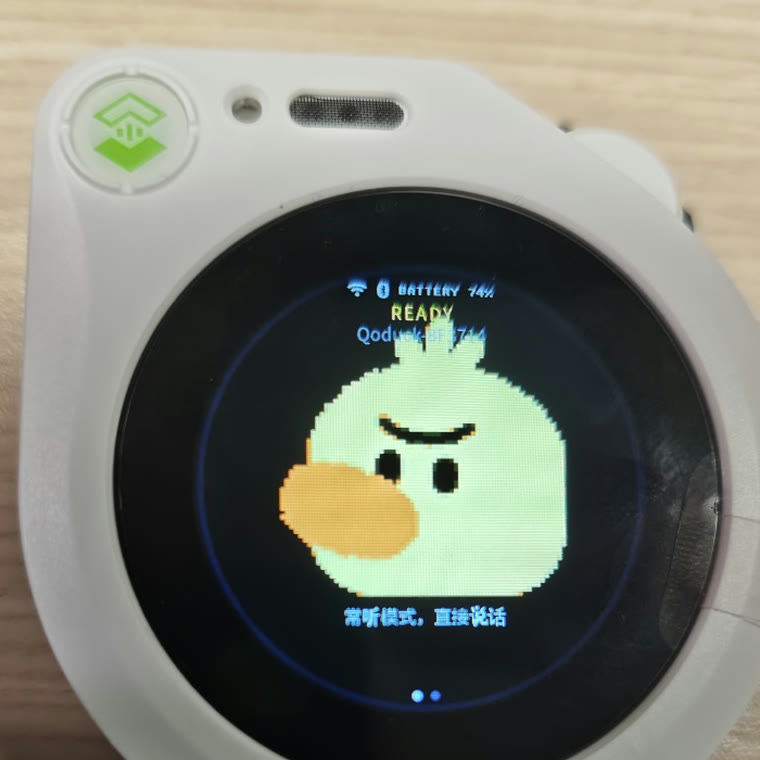
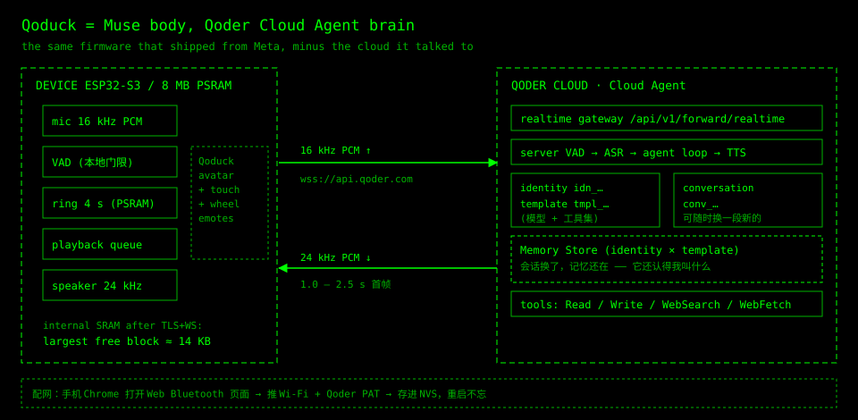
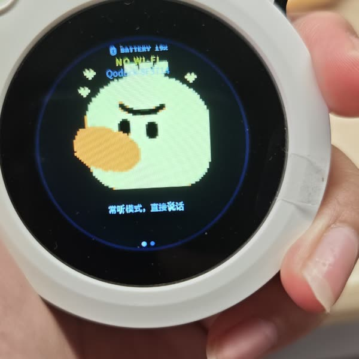
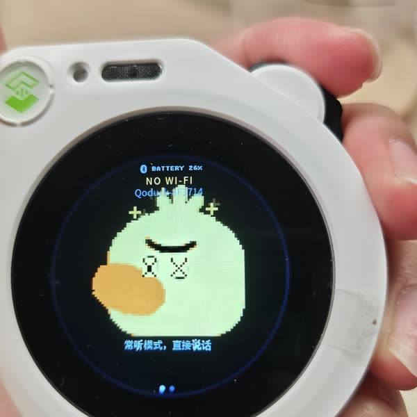
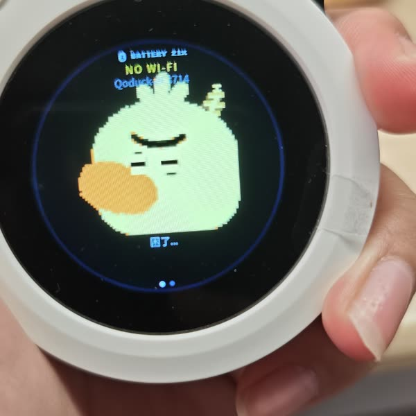
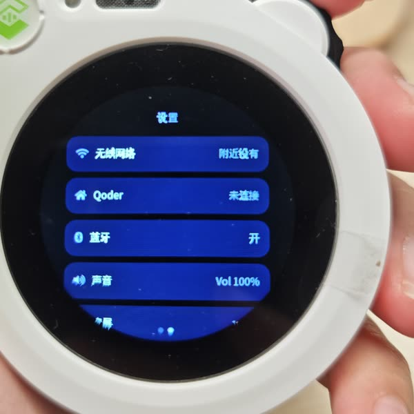

<div class="lang-section" data-lang="en">

I have never soldered anything that worked. In university, hardware was the subject I hated most: analog circuits, digital circuits, signals and systems, and the labs that came with them. I moved to software and stopped thinking about it.

Yesterday I turned a $60 plastic duck into a voice assistant backed by a cloud agent. It answers in about a second and a half, remembers my name across reboots, plays a goodbye animation when it powers off, and spins around with X-shaped eyes if you double-click its scroll wheel. When a question needs actual work — check a merge request, read a page, search the web — it goes quiet for a minute and then says the answer out loud. It took most of a day.

<figure style="margin: 2rem 0; text-align: center;">
  
  <figcaption style="margin-top:.6rem;opacity:.75;">The duck, a day after surgery. The caption says READY and “常听模式，直接说话” — always listening, just talk.</figcaption>
</figure>

## The patch that started it

It began with [esp32-thinks](https://github.com/raullenchai/esp32-thinks), a small repository of patches that takes [muse-gadget-sdk](https://github.com/facebookincubator/muse-gadget-sdk) — Meta's open-source SDK for gadgets with a screen, a mic and a speaker — and points its brain at any OpenAI-compatible endpoint.

I took the Muse brain side apart to see what it actually needs. Three things, and no more:

| What it needs | Why |
|---|---|
| voice in and out | mic up, speaker down, fast enough to feel like a conversation |
| a VM to run things in | the interesting half of an agent is what it *does* — commands, files, searches |
| an LLM API | the persona, and the judgement about what to say next |

esp32-thinks answers all three with three separate HTTP services: a transcription endpoint, a chat completion, a speech endpoint. That is why the patch is small — and also why there is a patch at all. The device has to stitch the three together itself, and a stitched pipeline has no tools and no memory.

Qoder Cloud Agent, which my employer happens to build, covers the same three needs inside a single session: realtime voice, a disposable sandbox per conversation, and the model behind it. It is the same shape as Anthropic's Managed Agents — you do not host the agent, you connect to one.

The docs are at [docs.qoder.com/cloud-agents](https://docs.qoder.com/cloud-agents/overview), and the two pages I actually lived in were [create a conversation](https://docs.qoder.com/cloud-agents/api/forward/realtime/create-conversation) and [connect to one](https://docs.qoder.com/cloud-agents/api/forward/realtime/connect). Ignore the duck for a second — the whole thing is four commands:

```bash
export QODER_PAT=...                   # https://qoder.com/cloud/pat-keys
API=https://api.qoder.com/api/v1/forward
AUTH="Authorization: Bearer $QODER_PAT"

# a sandbox environment and an agent template are the two halves of a brain
curl -s "$API/environments" -H "$AUTH" | jq -r '.data[] | "\(.id)  \(.config.type)"'
curl -s "$API/templates"    -H "$AUTH" | jq -r '.data[] | "\(.id)  \(.name)"'

# identity = who is talking, template = what it is allowed to do
curl -s -X POST "$API/realtime/conversations" \
  -H "$AUTH" -H 'Content-Type: application/json' \
  -H "Idempotency-Key: $(uuidgen)" \
  -d '{"identity_id":"idn_xxx","template_id":"tmpl_xxx","title":"duck",
       "config":{"audio":{"output":{"voice":"longanqian"}}}}' \
  | jq -r .id
# → conv_xxx
```

That last command prints a `conv_…` id. Everything else is one WebSocket to `wss://api.qoder.com/api/v1/forward/realtime?conversation_id=conv_xxx`, carrying `audio.append` frames up at 16 kHz and `audio.delta` frames down at 24 kHz. The firmware in this post is that client, plus a screen and a speaker — there is no second protocol to learn.

## Why one session instead of STT + chat + TTS

The obvious swap is still speech-to-text, one chat completion, then text-to-speech, over plain HTTPS. It works, and it is where most of these firmware patches stop. But it gives up the parts that make an agent an agent: tools, memory, and the ability to do things rather than describe them.

Qoder Cloud Agents exposes a realtime voice endpoint — a single WebSocket, 16 kHz PCM up, 24 kHz PCM down, with VAD, ASR, LLM and TTS on the server — and it is the same session that can read files, write files, search the web and remember you. The duck is not a talking toy; it is a terminal with a mouth.

Of that one session, the firmware leans on three properties:

- **One socket for everything.** Audio up, audio down, captions and tool events all travel on the same WebSocket (`/api/v1/forward/realtime?conversation_id=…`). No stitching STT into a chat completion into TTS, no second control channel, no turn state machine on a device with 14 KB of contiguous RAM.
- **Every conversation is a fresh throwaway sandbox.** Creating a conversation spins up an isolated machine with a shell and a filesystem, and it is destroyed when the conversation ends (sixty minutes at most). I do not run a server, I do not patch one, and nothing on a $60 gadget can do damage beyond one conversation.
- **Memory outlives the sandbox.** Memory stores are mounted per `(identity, template)`, not per sandbox, so a reboot, a network drop or a brand-new conversation all land in the same memory.

## What actually happens on that socket

This is the part that made me buy the hardware. There is one long-lived WebSocket, and everything the duck does is a variation of the same four steps:

1. **It listens.** While awake, the device streams 16 kHz PCM up the socket continuously. The server runs the VAD and the transcription, so the firmware has no concept of a "turn" — no wake word, no button, no end-of-speech detection to get wrong.
2. **The agent decides what this is.** The transcript lands in the model inside the same session, with the same tools and the same memory. Most sentences are conversation and get answered in place, in about a second.
3. **Some sentences start a session that works.** "Check whether my MR broke CI", "summarise what happened in the group chat", "what is the weather in Hangzhou on Saturday". That becomes a session running inside the conversation's sandbox: the agent calls tools, reads files, runs commands. This is the part that takes minutes, and it happens entirely on the other side of the socket — the duck has nothing to do but keep the connection alive.
4. **It reports back.** When the session finishes, the result comes down the same connection as speech, with a caption on the round screen. No polling, no push notification, no second API, no "I'll let you know" — it goes quiet for a while and then tells me what it found.

That last step is the whole reason this design beats a chat box. A phone notification makes me look at a screen. This thing waits until I am in the same room and says it out loud. It also means the firmware never has to know what a task is: from the device's point of view, the audio just takes longer sometimes.

The rest is bookkeeping:

| Object | Lives | Lifetime | Meaning |
|---|---|---|---|
| `identity` | platform | forever | who the user is |
| `template` | platform | forever | model, system prompt, tool set |
| `conversation` | platform | one socket, 60 min max | one working context |

Memory is not in the conversation. It is stored per `(identity, template)` and mounted into every session of that pair. That one design decision is why the duck still knows my name after a reboot, or after I throw away the conversation and start a new one.

<figure style="margin: 2rem 0;">
  
  <figcaption style="margin-top:.6rem;text-align:center;opacity:.75;">Everything left of the arrow is Meta's firmware. Everything right of it is one WebSocket.</figcaption>
</figure>

## Before buying hardware, I built a simulator

The temptation is to order the thing first and start hacking. I built a browser simulator first instead: a small Node server speaking the same realtime protocol, and a page that opens the microphone, runs a VAD, streams PCM up and plays back what comes down.

Two hours later I had the only number that decides whether the project is worth doing: **1.0–2.5 s from the end of my speech to the first audio frame**. Below a second it feels like a conversation. Above four it feels like a walkie-talkie.

Testing the cloud half in a browser also paid off later. When the hardware misbehaved, I already knew which half was misbehaving, and almost every bug in the following 24 hours turned out to be on the device side.

## The duck

The hardware is a [Seeed SenseCAP Watcher](https://www.seeedstudio.com/SenseCAP-Watcher-W1-A-p-5979.html): ESP32-S3 at 240 MHz, 8 MB of octal PSRAM, 32 MB of flash, a round 412×412 touch LCD, a camera I never use, a mic, a speaker, and — the part that matters — an enclosure you would leave on a desk. About $55–62 depending on the vendor. No soldering iron, just a USB-C cable.

Muse supported this board already, so the day's work was not hardware bring-up. It was talking an existing firmware into using a different cloud without breaking anything that made it pleasant.

## Seven things that went wrong

**1. Two owners for one microphone.** Muse has push-to-talk and an always-listening mode, and its voice task owns the codec. My component wanted to own it too. The first symptom was silence: the state machine politely refused to record, because from its point of view Muse was never set up. The fix was a negotiation — a weak symbol, `qca_voice_owns_mic()`, so the old task stands down only when the new one is present.

**2. The eight-minute-old voice.** The uplink queue pulled audio from a ring buffer; when the ring was full, samples were dropped, but the accounting still counted them as delivered. Playback finished, the device never acknowledged the segment, the server stopped sending, and the queue grew silently. Minutes later someone spoke again, the pipeline flushed, and eight minutes of stored audio arrived at once. The duck answered a question I had forgotten asking.

Same bug, second lesson: the ESP32-S3 has 512 KB of internal SRAM, and after Wi-Fi, TLS and a WebSocket only about 14 KB of it is still contiguous. A 1.5-second ring buffer allocated from internal RAM is a coin flip. It now lives in PSRAM, four seconds of it.

**3. A startup race that boot-looped the device.** The voice task started before the settings module was initialized and read NVS through a mutex that did not exist yet: `assert failed: xQueueSemaphoreTake`, then a reboot loop. It now waits for a `muse_settings_ready()` flag and does its one-time setup lazily.

**4. Web Bluetooth that could not see the device.** The provisioning page got an empty list from `requestDevice({filters:[{services:[…]}]})`, because the firmware advertises the vendor's UUID and not mine. An advertisement is 31 bytes; you do not get to add what you like. Filtering by `namePrefix: 'Qoduck'`, which lives in the scan response, fixed it, plus a "show everything" button as a fallback.

**5. Tokens are per-site, and TLS is not optional.** The key I had was issued for `qoder.com`; the `.cn` deployment returned `TOKEN_INVALID`. And an ESP32 does not ship with a useful root store, so the firmware carries the actual certificate chain (SHECA DV TLS RSA CA A1, chaining to UCA Global G2 Root) and pins it.

**6. Chinese text rendered as tofu.** The UI was full of `[]`. LVGL's built-in CJK font covers UI strings, not arbitrary Chinese. The SDK already ships a 16 px Unifont with the full `0x4E00–0x9FFF` range as a 6.5 MB C file, so the fix was to use it as an LVGL font *fallback* rather than replacing the nicer font everywhere.

**7. Every experiment costs four minutes.** Flashing this board over serial takes four minutes, and there is no faster path I know of. Software people forget how much of their iteration speed comes from a compiler that returns in 0.4 s. On hardware, one wrong hypothesis costs a coffee. The answer was to batch three changes per flash and to add a serial command for anything I might want to check, so most verification never needs a flash at all. Related: opening the serial port with default DTR/RTS handling resets the device, so the first thing you lose is the crash you wanted to see.

## What it does now

Wake it, talk, and it answers in about a second and a half. It stays listening, so there is no button to press. Ask it for something that needs work — "is my merge request still green?" — and it goes quiet, then reads the result out when the session finishes. Swipe for a Chinese settings UI: Wi-Fi, the Qoder token, Bluetooth pairing, volume, brightness, screen timeout, battery. Say "my reports are due on Friday", reboot, and it still knows.

The scroll wheel is the only physical button, so we gave it a personality:

| Gesture | Response |
|---|---|
| tap | hops once, hearts float out of both ears |
| double-tap | spins around, stars orbit its head, eyes turn into X |
| turn | looks left and right |
| hold 1.2 s | dozes off, Zzz drifting up |
| hold 2.4 s | sleeps |
| hold 4.2 s | powers off: blink, sink, then the pixels dissolve with an ordered dither while the backlight fades on the same clock |

<div style="display:flex;flex-wrap:wrap;gap:1rem;justify-content:center;margin:2rem 0;">
  <figure style="flex:1 1 160px;max-width:210px;margin:0;text-align:center;">
    
    <figcaption style="margin-top:.4rem;font-size:.85em;opacity:.75;">idle — “always listening, just talk”</figcaption>
  </figure>
  <figure style="flex:1 1 160px;max-width:210px;margin:0;text-align:center;">
    
    <figcaption style="margin-top:.4rem;font-size:.85em;opacity:.75;">double-tap — eyes turn into X</figcaption>
  </figure>
  <figure style="flex:1 1 160px;max-width:210px;margin:0;text-align:center;">
    
    <figcaption style="margin-top:.4rem;font-size:.85em;opacity:.75;">hold 1.2 s — dozing off</figcaption>
  </figure>
  <figure style="flex:1 1 160px;max-width:210px;margin:0;text-align:center;">
    
    <figcaption style="margin-top:.4rem;font-size:.85em;opacity:.75;">swipe — settings: Wi-Fi, Qoder, Bluetooth, volume</figcaption>
  </figure>
</div>

The shutdown animation is my favourite, because it is the kind of thing that is easy in software and annoying in hardware: 1.5 seconds of animation that has to finish before the power rail is cut, on a device whose only debug output is a serial line. We tuned it by dumping the 64×64 avatar grid as ASCII over the console and reading the frames like a flipbook.

## What I actually learned

The bottleneck was never typing. It was observation. In software, debugging is `printf` and a debugger. In hardware you cannot grep a speaker, and you cannot put a breakpoint on a scroll wheel. Most of the skill is building observation channels — serial logs, ASCII dumps, an `emote` console command — so that a machine that can only say one sentence at a time can still tell you what it is thinking. A four-minute flash is not a tooling annoyance; it is a tax on how many questions you are allowed to ask per hour.

The other lesson is about the seam. Muse was open source except for the part that made it a product, and the moment that part became a socket, the product became a weekend.

## Vibe software is tiring. Vibe hardware has barely started

I am tired of vibe software. Another dashboard that generates another landing page for another agent that summarizes another inbox. Producing software got cheap, so the supply exploded, and "it works" stopped being interesting. Everyone has seen the demo.

Hardware is different right now, in the way LLMs were different in 2023. The parts are absurdly capable and cheap: an ESP32-S3 with 8 MB of PSRAM costs less than lunch, 3D printing is a commodity, and the modules all speak documented protocols. What was missing was never the electronics. It was the glue — the few thousand lines of driver-fighting between "the board boots" and "the thing behaves". Glue is exactly what an LLM is good at.

Which suggests the next few years. Vibe mechanical: describe the joint, get the linkage, print it, watch it jam, describe the jam. Vibe furniture: a shelf that measures itself and gets reprinted when you move. Vibe city: a neighbourhood's traffic timing tuned as a prompt and an eval instead of a five-year procurement. Vibe lab: an instrument that does not exist yet, assembled from modules and a little personality.

I still cannot read a schematic, and I still flinch at the word "analog". But there is a duck on my desk that remembers my name and got dizzy last night because I clicked its wheel twice, and I built it by talking. The firmware is at [github.com/adlternative/esp32-qoduck](https://github.com/adlternative/esp32-qoduck) — a fork of [muse-gadget-sdk](https://github.com/facebookincubator/muse-gadget-sdk) with the changes squashed into one commit (the setup guide, the BLE provisioning page and the serial commands are in `skills/qoduck-setup/SKILL.md`). The patch repository that started it is [esp32-thinks](https://github.com/raullenchai/esp32-thinks).

</div>

<div class="lang-section" data-lang="zh">

我焊过的东西从来没有正常工作过。大学里硬件是我最讨厌的科目：电路分析、模电、数电、信号与系统，以及跟着它们的那些实验课。后来我转去做软件，就不再想这件事了。

昨天我把一只六十美元的塑料鸭子改成了一个跑在云端 Agent 上的语音助手。它一秒半左右开始回答，重启之后还记得我叫什么，断电前会演一段告别动画，双击它的滚轮它会当场转晕。碰到真需要干活的请求 —— 查一个 MR、读一个网页、搜一下 —— 它会安静一分钟，然后把答案念出来。整个过程花了大约一天。

<figure style="margin: 2rem 0; text-align: center;">
  
  <figcaption style="margin-top:.6rem;opacity:.75;">手术一天之后的鸭子。屏幕上写着 READY 和「常听模式，直接说话」。</figcaption>
</figure>

## 事情是从一个 patch 开始的

起点是一个叫 [esp32-thinks](https://github.com/raullenchai/esp32-thinks) 的仓库：一小撮 patch，把 [muse-gadget-sdk](https://github.com/facebookincubator/muse-gadget-sdk)（Meta 开源的、给“有屏幕有麦克风的小玩意儿”用的 SDK）的大脑指向任意 OpenAI 兼容端点。

我先把 muse 的“大脑”那一侧拆了开来看：它到底需要什么。就三样，不多：

| 需要什么 | 干嘛用的 |
|---|---|
| 语音输入输出 | 麦克风上行、扬声器下行，延迟要低到像在对话 |
| 一台能跑东西的虚拟机 | agent 有意思的那一半是它**做了什么**：执行命令、读写文件、搜东西 |
| 一个 LLM 接口 | 人设，以及“下一句该说什么”的判断 |

esp32-thinks 用三个独立的 HTTP 服务回答了这三件事：一个转写接口、一次聊天补全、一个语音接口。这就是为什么这个 patch 很小 —— 也是为什么它必须得是个 patch：设备得自己把三段缝起来，而缝出来的流水线没有工具，也没有记忆。

我们公司的 Qoder Cloud Agent 把这三件事装进同一个会话里：实时语音、每个会话一个随用随丢的沙箱、以及背后的模型。形状和 Anthropic 的 Managed Agents 一样 —— 你不去托管一个 agent，你连上一个 agent。

文档在 [docs.qoder.com/cloud-agents](https://docs.qoder.com/zh/cloud-agents/overview)，我真正用到的是两页：[建一个会话](https://docs.qoder.com/zh/cloud-agents/api/forward/realtime/create-conversation) 和 [连上它](https://docs.qoder.com/zh/cloud-agents/api/forward/realtime/connect)。先不管那只鸭子，整件事就是四条命令：

```bash
export QODER_PAT=...                   # https://qoder.com/cloud/pat-keys
API=https://api.qoder.com/api/v1/forward
AUTH="Authorization: Bearer $QODER_PAT"

# 一个沙箱环境 + 一个 agent 模板，就是大脑的两半
curl -s "$API/environments" -H "$AUTH" | jq -r '.data[] | "\(.id)  \(.config.type)"'
curl -s "$API/templates"    -H "$AUTH" | jq -r '.data[] | "\(.id)  \(.name)"'

# identity = 谁在说话，template = 它被允许做什么
curl -s -X POST "$API/realtime/conversations" \
  -H "$AUTH" -H 'Content-Type: application/json' \
  -H "Idempotency-Key: $(uuidgen)" \
  -d '{"identity_id":"idn_xxx","template_id":"tmpl_xxx","title":"duck",
       "config":{"audio":{"output":{"voice":"longanqian"}}}}' \
  | jq -r .id
# → conv_xxx
```

最后那条命令会吐一个 `conv_…`。剩下的全部是一条 WebSocket：`wss://api.qoder.com/api/v1/forward/realtime?conversation_id=conv_xxx`，上行是 16 kHz 的 `audio.append` 帧，下行是 24 kHz 的 `audio.delta` 帧。这篇文章里的固件就是那个客户端，加一块屏和一个喇叭 —— 没有第二套协议要学。

## 为什么是一个会话，而不是 STT + chat + TTS

最直觉的替换依然是：语音转文字，调一次聊天接口，再文字转语音，全走 HTTPS。它能用，大部分这类固件 patch 也都在这里停手。但它扔掉了让 agent 成为 agent 的部分：工具、记忆，以及“做事”而不只是“描述事”的能力。

Qoder Cloud Agents 提供实时语音接口 —— 一条 WebSocket，上行 16 kHz PCM，下行 24 kHz PCM，VAD / ASR / LLM / TTS 都在服务端 —— 而且它就是那个能读写文件、能搜网页、能记住你的同一个会话。这只鸭子不是一个会说话的玩具，它是一个有嘴的终端。

那条会话里，固件真正用上的只有三条性质：

- **一条 socket 什么都干。** 上行音频、下行音频、字幕和工具事件都走同一条 WebSocket（`/api/v1/forward/realtime?conversation_id=…`）。不需要把 STT、聊天、TTS 缝合起来，不需要第二条控制通道，也不需要在只有 14 KB 连续内存的设备上维护回合状态机。
- **每个会话都是一个随用随丢的沙箱。** 新建会话时平台起一台带 shell 和文件系统的隔离机器，会话结束（最长六十分钟）就销毁。我不用跑服务、不用给它打补丁，这块六十美元的板子上也没有任何东西能做出超过一个会话的危害。
- **记忆活得比沙箱久。** 记忆按 `(identity, template)` 这一对挂载，不跟着沙箱走，所以重启、掉网、甚至开一个全新的会话，落到的都是同一份记忆。

## 这条 socket 上到底发生了什么

这才是让我下单的部分。只有一条长连 WebSocket，鸭子做的一切都是同四步的变体：

1. **它一直在听。** 醒着的时候，设备把 16 kHz PCM 持续推到上行。VAD 和转写都在服务端，所以固件里根本没有“回合”这个概念 —— 没有唤醒词、没有按键、没有需要调对的断句检测。
2. **Agent 判断这句话是什么。** 转写结果落到同一个会话里的模型手上，带着同一套工具和同一份记忆。大多数句子是闲聊，一秒左右当场就答了。
3. **有些句子会开一个真干活的会话。** “看看我的 MR 是不是把 CI 搞挂了”、“帮我总结一下群里刚才聊了什么”、“周六杭州天气怎么样” —— 那就变成一个跑在会话沙箱里的 session：agent 调工具、读文件、执行命令。这一段是能跑几分钟的，而且全部发生在 socket 的那一头，鸭子只需要把连接保住。
4. **它回来汇报。** 会话结束时，结果通过同一条连接下来，变成语音，同时圆屏上出字幕。没有轮询、没有推送通知、没有第二个 API，也没有“我待会儿告诉你” —— 它安静一阵，然后开口告诉我它查到了什么。

最后这一步才是这套设计胜过聊天框的全部原因。手机通知会让我去看屏幕；这个东西会等到我在同一个房间里，然后直接说出来。它还有个副作用：固件永远不需要知道“什么是一个任务” —— 从设备角度看，只是这次的音频回得慢一点。

剩下的都是记账：

| 对象 | 在哪 | 生命周期 | 含义 |
|---|---|---|---|
| `identity` | 平台 | 永久 | 你是谁 |
| `template` | 平台 | 永久 | 模型、system prompt、工具集 |
| `conversation` | 平台 | 单条 socket 最多 60 分钟 | 一段工作上下文 |

记忆不在 conversation 里，它按 `(identity, template)` 这一对存放，并挂到这一对的每个会话上。就是这个设计决定，让鸭子在重启之后、在我扔掉旧会话开新会话之后，依然知道我叫什么。

<figure style="margin: 2rem 0;">
  
  <figcaption style="margin-top:.6rem;text-align:center;opacity:.75;">箭头左边全是 Meta 的固件，右边只有一条 WebSocket。</figcaption>
</figure>

## 买硬件之前，先写了个模拟器

人的本能是先把东西下单，然后开始改。我先写的是一个浏览器里的模拟器：一个说同一套实时协议的 Node 小服务，加一个页面 —— 打开麦克风、跑一个 VAD、把 PCM 推上去、把回来的音频播出来。

两小时之后我拿到了唯一能决定这个项目值不值得做的数字：**从我停止说话到第一帧声音，1.0–2.5 秒**。一秒以内像对话，四秒以上像对讲机。

先在浏览器里跑通云端那一半，后面还有回报。硬件出问题时，我已经知道是哪一半出了问题，而接下来 24 小时里的 bug 几乎全在设备端。

## 那只鸭子

硬件是 [Seeed SenseCAP Watcher](https://www.seeedstudio.com/SenseCAP-Watcher-W1-A-p-5979.html)：ESP32-S3 @240 MHz、8 MB 八线 PSRAM、32 MB flash、412×412 圆屏（带触摸）、一个我从来没用过的摄像头、麦克风、扬声器，以及最重要的部分 —— 一个你愿意放在桌上的外壳。价格 55–62 美元，看你从哪买。不需要电烙铁，一根 USB-C 线就够。

Muse 本来就支持这块板子，所以这一天的活不是硬件 bring-up，而是说服一套现成的固件换一个云端，同时别把它原来让人舒服的部分弄坏。

## 七个出问题的地方

**一、一个麦克风，两个主人。** Muse 有 PTT 和常听两种模式，它的语音任务拥有 codec。我的组件也想要。第一个症状是沉默 —— 状态机很礼貌地拒绝录音，因为在它看来 Muse 从来没配置完成。解决办法是一次谈判：加一个弱符号 `qca_voice_owns_mic()`，只有新的大脑在场时旧语音任务才退下。

**二、晚了八分钟的声音。** 上行队列从环形缓冲取样；缓冲满了就丢采样，但账照记，被丢掉的也算成已送出。播放播完，设备永远不回执，服务端就不再加发，队列无声地涨。几分钟后谁又说了句话，链路一 flush，八分钟的库存音频一次性涌出来。鸭子回答了一个我早就忘了的问题。

同一个 bug 还有第二课：ESP32-S3 只有 512 KB 内部 SRAM，而 Wi-Fi + TLS + WebSocket 之后，能拿出的连续块只剩大约 14 KB。用内部 RAM 分配一个 1.5 秒环形缓冲是在抛硬币。现在它在 PSRAM 里，四秒。

**三、开机的竞态让设备进了重启循环。** 语音任务在设置模块初始化之前就启动了，去读 NVS，而它等的那把锁还不存在：`assert failed: xQueueSemaphoreTake`，然后无限重启。现在它等一个 `muse_settings_ready()` 标志，把一次性初始化做成惰性的。

**四、Web Bluetooth 看不见设备。** 配网页从 `requestDevice({filters:[{services:[…]}]})` 拿回一个空列表，因为固件广播的是厂商的 UUID，不是我的。广播只有 31 个字节，不是想加什么就加什么。改成按 `namePrefix: 'Qoduck'` 过滤（名字在 scan response 里）就好了，另外加了一个“把全部设备列出来”的兜底按钮。

**五、token 分站点，TLS 不是可选项。** 我手里的 key 是 `qoder.com` 签的，打 `.cn` 直接 `TOKEN_INVALID`。而一块 ESP32 默认不认识那套 CA，所以固件里带着真正的证书链（SHECA DV TLS RSA CA A1 → UCA Global G2 Root）并做 pin。

**六、中文全变成方块。** 界面到处是 `[]`。LVGL 自带的中文字体覆盖 UI 文案，不覆盖任意中文。SDK 里其实已经有一个 16 px 的 Unifont，包含完整 `0x4E00–0x9FFF`，是一个 6.5 MB 的 C 文件 —— 所以正确的做法是把它设成 LVGL 字体的 **fallback**，而不是把好看的字体全换掉。

**七、每个实验值四分钟。** 这块板子串口刷一次四分钟，我不知道更快的办法。写软件的人忘了自己的迭代速度有多少来自 0.4 秒的编译器。在硬件上，一个错误的假设和一杯咖啡等价。最后的对策是：每次刷机攒三个改动，并且给任何想验证的东西加一条串口命令，让大部分验证根本不需要刷机。还有一个相关的坑：串口默认的 DTR/RTS 处理会复位设备，所以你丢掉的第一个现场，正是你想看的那个崩溃。

## 现在它会什么

叫醒它、说话，一秒半之后它开始回答。它一直在听，所以没有按键这个动作。让它干点真活 —— 「我的 MR 还是绿的（CI 通过）吗」—— 它会安静下来，等会话跑完再把结果念出来。左右滑动是中文设置页：Wi-Fi、Qoder token、蓝牙配对、音量、亮度、息屏、电池。跟它说“我的周报周五要交”，重启，它还记得。

滚轮是它唯一的实体按键，所以我们给了它一点性格：

| 手势 | 反应 |
|---|---|
| 按一下 | 蹦一下，两只耳朵边飘出小心心 |
| 双击 | 当场转圈，头顶星星绕圈，眼睛变成 X |
| 转一下 | 东张西望 |
| 按住 1.2 秒 | 打瞌睡，Zzz 往上飘 |
| 按住 2.4 秒 | 睡着 |
| 按住 4.2 秒 | 关机：闭眼、低头，然后像素按有序抖动散开，背光在同一时钟上淡出 |

<div style="display:flex;flex-wrap:wrap;gap:1rem;justify-content:center;margin:2rem 0;">
  <figure style="flex:1 1 160px;max-width:210px;margin:0;text-align:center;">
    
    <figcaption style="margin-top:.4rem;font-size:.85em;opacity:.75;">待命 —— 「常听模式，直接说话」</figcaption>
  </figure>
  <figure style="flex:1 1 160px;max-width:210px;margin:0;text-align:center;">
    
    <figcaption style="margin-top:.4rem;font-size:.85em;opacity:.75;">双击 —— 眼睛变成 X</figcaption>
  </figure>
  <figure style="flex:1 1 160px;max-width:210px;margin:0;text-align:center;">
    
    <figcaption style="margin-top:.4rem;font-size:.85em;opacity:.75;">按住 1.2 秒 —— 打瞌睡</figcaption>
  </figure>
  <figure style="flex:1 1 160px;max-width:210px;margin:0;text-align:center;">
    
    <figcaption style="margin-top:.4rem;font-size:.85em;opacity:.75;">滑动 —— 设置：无线网络、Qoder、蓝牙、声音</figcaption>
  </figure>
</div>

关机动画是我最喜欢的，因为它正好是“软件里容易、硬件里烦”的那类东西：1.5 秒的动画必须在电源被切断之前播完，而设备的全部调试输出只有一条串口线。我们的调法是：把 64×64 的头像网格打成 ASCII 打到串口，像翻页动画一样一帧一帧读。

## 我到底学到了什么

瓶颈从来不是打字，是**观察**。软件里调试是 `printf` 和调试器；硬件里你没法 grep 一个扬声器，也没法给滚轮打断点。大部分的技能是给自己造观察通道 —— 串口日志、ASCII dump、一条 `emote` 控制台命令 —— 让一台一次只能说一句话的机器，仍然能告诉你它在想什么。四分钟一次的刷机不是工具的问题，它是对「每小时你能问几个问题」的征税。

另一个教训关于那道缝。Muse 开源了除了“让它成为产品”的那个部分，而当那个部分变成一个 socket，这个产品就变成了一个周末。

## Vibe 软件让人累了，Vibe 硬件才刚开始

我对 vibe 软件已经腻了。又一个 dashboard 又生成了一个 landing page，给又一个 agent，去总结又一个收件箱。生产软件变便宜了，供给就爆炸，“它跑起来了”不再有意思，演示人人都看过。

硬件现在不一样，像 2023 年的 LLM。零件强得离谱也便宜得离谱：带 8 MB PSRAM 的 ESP32-S3 比一顿午饭便宜，3D 打印是日用品，模组全都说着有文档的协议。缺的从来不是电子，缺的是**胶水** —— “板子能启动”和“东西真的有行为”之间那几千行的驱动缠斗。而那恰好是大模型真正擅长的地方。

所以接下来几年大概是这个样子。Vibe 机械：描述一个关节，拿到连杆，打出来，看它卡住，描述卡住的样子。Vibe 家具：一个会自己量尺寸、你搬家它就重打的架子。Vibe 城市：一个小区的红绿灯配时当作 prompt 和 eval 来调，而不是走五年的采购流程。Vibe 实验室：一台还不存在的仪器，用模组和一点性格拼出来。

我还是不会看原理图，听到“模电”两个字还是会本能地后仰。但我桌上有一只鸭子，它记得我的名字，而且昨天晚上因为我双击了它的滚轮，它当场转晕了 —— 而我是靠说话把它做出来的。固件在 [github.com/adlternative/esp32-qoduck](https://github.com/adlternative/esp32-qoduck)：[muse-gadget-sdk](https://github.com/facebookincubator/muse-gadget-sdk) 的 fork，改动压成了一个提交（接入指南、蓝牙配网页和串口命令都在 `skills/qoduck-setup/SKILL.md`）。最初点着我的那个 patch 仓库是 [esp32-thinks](https://github.com/raullenchai/esp32-thinks)。

</div>
